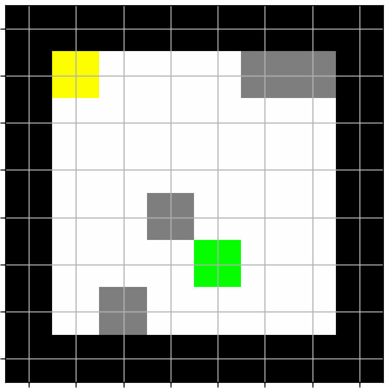
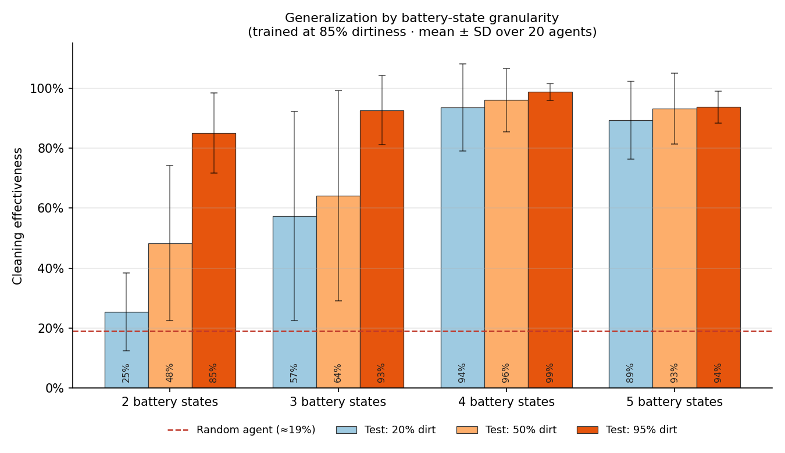
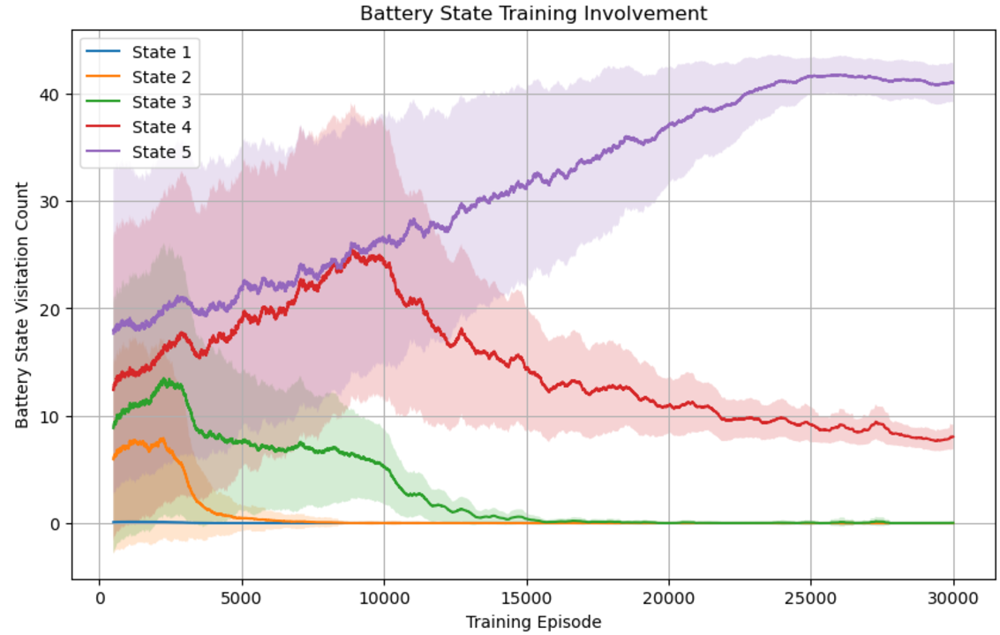
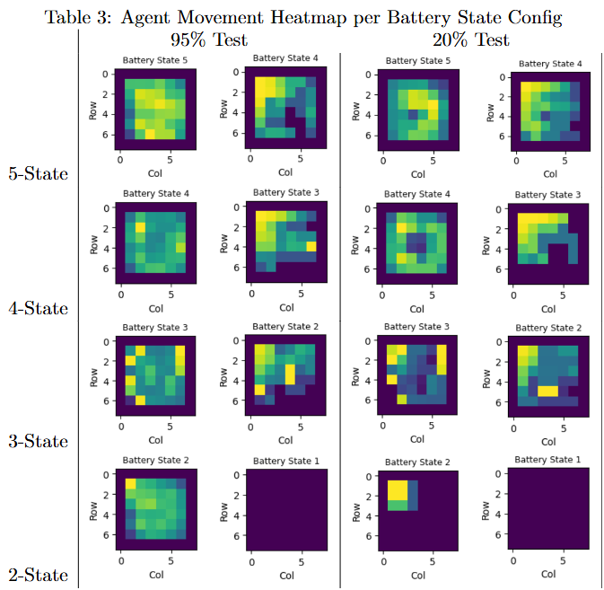

<div align="center">

# 🤖 The Robovac Problem

### A resource-constrained reinforcement learning environment where an agent must *search*, *act*, and *get home* before the battery dies

**Adam Parker · Chuck de Sully**
Johns Hopkins University, Whiting School of Engineering · 2024

[](./docs/robovac_problem_parker_desully_2024.pdf)


</div>

---

## TL;DR

The Robovac Problem is a new RL environment based on a robotic vacuum. It is a relaxation of the **Traveling Salesman Problem**: the agent may *visit* a tile many times but should *clean* each dirty tile only once. It does not know where the dirt is, it has a draining battery, and it has to make it back to its charging station.

Using tabular Q-learning, we studied how two design decisions shape what an agent learns and how well it generalizes:

| | |
|---|---|
| 🧹 **19% → 89%+** | Cleaning effectiveness of a random agent vs. trained agents with 4–5 battery states, across every test condition |
| 🔋 **Richer state, better policy** | 4- and 5-state battery representations decisively beat 2- and 3-state ones in unfamiliar environments (p < 0.001) |
| 📉 **Agents prune their own state space** | Agents given 5 battery levels converge to using only ~2 during training, yet still outperform agents that only *had* 2 |
| 🏠 **Emergent return-to-base behavior** | With enough battery resolution, agents learn a distinct "explore" phase and a "head home" phase, visible in movement heatmaps |

---

## The Environment

<p align="center">
  
  <br/>
  <sub>Black = walls · White = clean · Grey = dirty · Yellow = charging station · Green = agent</sub>
</p>

Each episode generates an 8×8 walled room. Every floor tile is independently dirty with probability *p* (the **dirtiness level**), and the charging station is placed against a wall. The agent starts at the station, and the episode ends when it **returns home** or its **battery dies**.

What makes the problem interesting is that it mixes two kinds of decisions that usually appear separately:

- **Search:** the agent can only see one tile in each direction, so it has to explore to find the dirt.
- **Action:** vacuuming costs extra battery and is penalized on an already-clean tile, so cleaning has to be deliberate.

All of this happens under a hard **resource budget**, so the agent has to judge when it is time to stop cleaning and head back.

### MDP specification

**Actions (8):** move N / S / E / W, each with the vacuum **on** or **off**.

**State:**

| Component | Values |
|---|---|
| Position | (row, col) on the grid |
| Battery level | Discretized into *k* levels (varied from 2 to 5 in our experiments) |
| Local look-ahead | For each cardinal neighbor: clean, dirty, or impassable |

In the baseline configuration this gives **8 × 8 × 3 × 3⁴ = 15,552 states**. That is small enough for a Q-table, and large enough that the choice of state design shows up in the results.

**Reward:**

| Event | Reward |
|---|---|
| Each move | −1 |
| Change of direction (turning time) | −2 |
| Vacuuming a dirty tile | +10 |
| Vacuuming an already-clean tile | −10 |
| Battery dies before reaching home | −10 per remaining dirty tile |

**Learning setup:** tabular Q-learning with α = 0.1, γ = 0.99, and ε-greedy exploration with ε annealed linearly from 0.75 to 0.01 over the first half of training. Each agent trains for 50,000 episodes, and every configuration is repeated with **20 independent agents**. Differences are tested with two-tailed t-tests.

---

## Key Results

### 1. Battery granularity drives generalization

All agents were trained at 85% dirtiness and then tested in rooms that were much cleaner (20%, 50%) or similar (95%).

<p align="center">
  
</p>

| Battery states | 20% test | 50% test | 95% test |
|:---:|:---:|:---:|:---:|
| 2 | 25.5% | 48.4% | 85.1% |
| 3 | 57.4% | 64.1% | 92.7% |
| **4** | **93.6%** | **96.0%** | **98.7%** |
| 5 | 89.4% | 93.2% | 93.7% |

<sub>Mean cleaning effectiveness over 20 agents. Full standard deviations and pairwise p-values are in Table 2 of the paper.</sub>

When the test environment resembles training (95%), every configuration does reasonably well. The differences show up **when conditions shift**: in a 20%-dirty room, the 2-state agents mostly stay near the base, while 4- and 5-state agents keep cleaning above 89%. All pairwise comparisons were statistically significant except 4 vs. 5 states at 50% dirtiness and 3 vs. 5 states at 95% dirtiness. The 4-state configuration performed best overall.

### 2. Agents converge to a smaller state space than they're given

<p align="center">
  
</p>

With 5 battery levels available, agents initially spend time in all of them. As training goes on, the policy becomes efficient enough that it rarely drains below the top two levels, and visits to lower states drop to zero. The 4- and 3-state configurations show the same pattern, settling on two active states.

**The counterintuitive part:** these agents still generalize far better than agents that only had two states to begin with. The extra resolution seems to matter most *during learning*, giving the agent room to discover a better strategy before it compresses its own behavior. This suggests a practical design pattern: train with a richer discretization, then collapse the unused states into a single catch-all state for deployment.

### 3. Learned behavior is interpretable: explore, then go home

<p align="center">
  
</p>

These heatmaps show where agents spend their time in each battery state. Brighter tiles mean more visits, and the charging base is in the upper-left.

- In the **4- and 5-state** agents, the full-battery state covers the whole room, and the next state down concentrates near the base. This is a **learned return-to-base strategy**, even though the reward never explicitly encourages going home.
- The **2-state** agents look competent in the familiar 95% environment but, in the 20% room, barely leave the base (about 25% coverage).
- Isolated bright spots point to agents getting stuck in back-and-forth loops, a failure mode that is more common with coarser battery representations.

### 4. Training conditions matter, within a narrow window

When we trained agents at fixed dirtiness levels and tested them across 0–100% dirtiness, generalization peaked for training levels around **85–95%**. Dense dirt seems to act like useful state noise: each episode is a slightly different environment, which exposes the agent to a wide range of local configurations without having to train separately at every dirtiness level.

---

## Repository Contents

```
RL_Roomba/
├── roomba.ipynb      # Environment, map generator, and tabular Q-learning agent
├── docs/
│   ├── robovac_problem_parker_desully_2024.pdf   # Full paper
│   └── figures/                                   # Figures used in this README
├── LICENSE           # MIT (code)
└── README.md
```

The notebook contains three main pieces:

- **`generate_roomba_map`**: a seeded room generator with configurable size and dirtiness.
- **`RoombaEnv`**: the environment, with movement, battery drain (vacuuming costs extra), local look-ahead, reward, and termination.
- **`QTabAgent`**: an ε-greedy tabular Q-learning agent.

> **Note:** The notebook is the core environment and agent implementation. Reward constants and the number of battery levels are configurable, so the values in the notebook may differ from the final experiment configuration. For reported results, the paper is the reference.

### Getting started

```bash
git clone https://github.com/cdesully/RL_Roomba.git
cd RL_Roomba
pip install numpy pandas tqdm jupyter
jupyter notebook roomba.ipynb
```

Python 3.11 or later is required, because the notebook uses starred-expression indexing.

---

## Limitations & Future Work

- **Scalability.** Tabular Q-learning grows exponentially with the state description. Deep RL with function approximation is the natural next step for larger rooms and continuous battery levels.
- **Robustness to the training distribution.** Sensitivity to training dirtiness points toward **curriculum learning** or **meta-learning** across dirtiness levels.
- **Reward design.** Return-to-base behavior emerged indirectly. Rewarding it explicitly, especially in sparse environments, may improve efficiency.
- **Adaptive state compression** *(proposed by Chuck de Sully; open research direction).* Agents leave some battery states unused after training, yet those states were valuable while learning. This suggests the discretization itself could be adapted during training: start with a rich state space, prune the states the policy stops visiting, and reallocate that resolution to where the policy still needs it. This direction has not yet been tested.

---

## Citation

```bibtex
@misc{parker2024robovac,
  author = {Parker, Adam and de Sully, Chuck},
  title  = {The Robovac Problem},
  year   = {2024},
  institution = {Johns Hopkins University, Whiting School of Engineering},
  url    = {https://github.com/cdesully/RL_Roomba}
}
```

## License

Code is released under the [MIT License](./LICENSE). The paper is © 2024 Parker and de Sully, licensed under [CC-BY 4.0](https://creativecommons.org/licenses/by/4.0/).

## Authors & Contributions

**Adam Parker** and **Chuck de Sully**, Johns Hopkins University, Whiting School of Engineering.

| Author | Contribution |
|---|---|
| **Adam Parker** | Problem formulation and environment design; experimental setup; training-dirtiness generalization study and its discussion (paper §1–3.1, §4.1; Key Result 4 above) |
| **Chuck de Sully** | Environment design; experimental setup; battery-state granularity study; state-utilization and convergence analysis; spatial exploration and behavior analysis; identification of the adaptive state-compression direction (paper §3.2, §4.2–4.3; Key Results 1–3 above) |

Both authors contributed to writing the paper.
